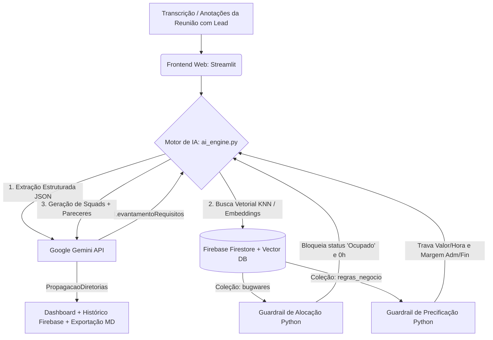
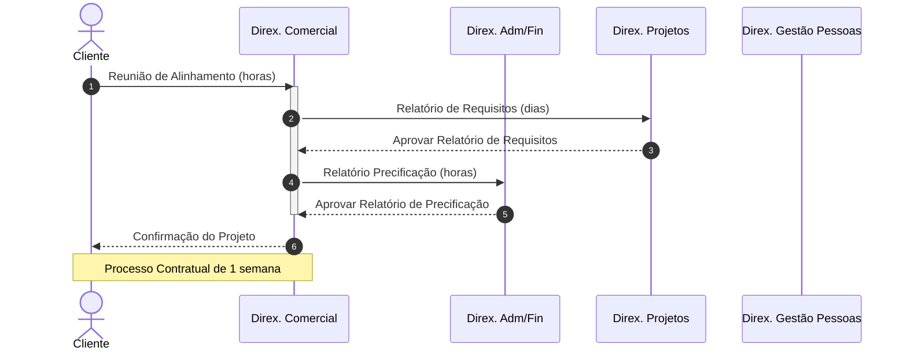

# Bugware SmartFlow

Prova de Conceito para o desafio V360 (disponível em `assets/Kick-off Batalha de Inovação Conecta v360.pdf`).

## Arquitetura de Software & Fluxo de Dados



## Governança, VectorDB e Guardrails Implementados

1. **Vector Search & Embeddings (`gemini-embedding-001` + Firestore `Vector`):** Os perfis técnicos de membros efetivos e trainees são convertidos em vetores de até 2048 dimensões e armazenados nativamente no Firestore, permitindo cálculo de similaridade de cosseno com a stack de cada projeto.
2. **Guardrail de Alocação (`aplicar_guardrails_membros`):** Trava determinística em Python que filtra qualquer membro com status `"Ocupado"` ou sem disponibilidade horária antes do envio ao contexto da LLM, além de instrução estrita contra alucinação de nomes fora do banco.
3. **Guardrail Financeiro (`calcular_orcamento_guardrail`):** Impede alucinações matemáticas da IA. O cálculo do piso de horas (40h), valor-hora (R$ 45,00) e margem de contingência (15%) é executado em código Python puro a partir dos parâmetros do Firestore.
4. **Padronização com Pydantic (`Structured Outputs`):** Uso de `response_schema` forçando respostas estritamente tipadas em JSON, garantindo estabilidade de 100% na interface.

## Modelo Antigo (Manual)



## Inicialização

Para inicializar o projeto, é necessário criar o arquivo `.env` baseado no arquivo `.env.example` e inserindo os dados apropriados para o ambiente de desenvolvimento/produção.

> [!note]
> Sugere-se fortemente o uso dos seguintes modelos (pela leveza e qualidade satisfatória do resultado):
> 
> gemini-3.8-flash
> gemini-3.6-flash
> gemini-3.5-flash-lite
> gemini-3.1-flash-lite

Além disso, também é necessário a chave do *Firebase*, crie um arquivo chamado `firebase_key.json` e hidráte-o com os dados de configuração do banco.

Para a utilização do ambiente virtual do python, é necessário criá-lo e ativá-lo:

```sh
# Criar o ambiente virtual
python -m venv venv

# Ativar o ambiente virtual no Linux
source venv/bin/activate

# Ativar o ambiente virtual no Windows (CMD)
venv\Scripts\activate.bat

# Ativar o ambiente virtual no Windows (PowerShell)
venv\Scripts\Activate.ps1
```

> [!tip]
> Para saber que o ambiente virtual está ativo, no terminal aparecerá (venv)

Para baixar as dependências do projeto, utilize o seguinte comando:

```sh
pip install -r requirements.txt
```

> [!note]
> Caso não haja dados populados no banco, recomenda-se utilizar o comando `python seed_firebase.py` antes de inicializar a página web do projeto.

Por fim, para inicializar a página web do projeto, utilize o seguinte comando (note que a rota ficará disponível na mensagem do terminal):

```sh
streamlit run app.py
```

## Coleções

No banco de dados *Firebase* estarão guardados os documentos a seguir:

```json
"bugwares": {
	"nome": "string",
	"cargo": "trainee" | "membro efetivo",
	"status": "livre" | "passivamente ocupado" | "ocupado",
	"area": "frontend" | "backend" | "mobile" | "ux/ui" | "dados/ia" | "qa" | "pm/po" | "devops",
	"habilidades": ["string"],
	"nivel_experiencia": "trainee" | "junior" | "pleno" | "senior",
	"horas_disponiveis": "number"
}

"regras_negocio": {
	"adm_fin": {
		"valor_hora": "number",
		"margem_seguranca_percentual": "number",
		"horas_minimas_projeto": "number"
	},
	"precificacao": {
		"valor_hora_base": "number",
		"taxa_urgencia": "number",
		"custo_fixo_infra": "number"
	}
}

"historico_leads": {
	"orcamento": {
		"horas_consideradas": "number",
		"orcamento_base_calculado": "number",
		"orcamento_com_margem_seguranca": "number",
		"valor_hora_tabela": "number"
	},
	"projeto": "string",
	"propagacao": {
		"impacto_juridico": ["string"],
		"insumos_adm_fin": "string",
		"opcoes_equipes": [
			// "equipe"
			{
				"foco_da_equipe": "string",
				"membros": [
					// "membro"
					{
						"cargo": "string",
						"justificativa_tecnica": "string",
						"nome": "string",
						"papel_no_projeto": "string"
					}
				],
				"nome_squad": "string"
			}
		]
	},
	"requisitos": {
		"complexidade": "string",
		"horas_estimadas_desenvolvimento": "number",
		"nome_projeto": "string",
		"requisitos_funcionais": ["string"],
		"requisitos_nao_funcionais": ["string"],
		"stack_sugerida": ["string"]
	}
}
```
